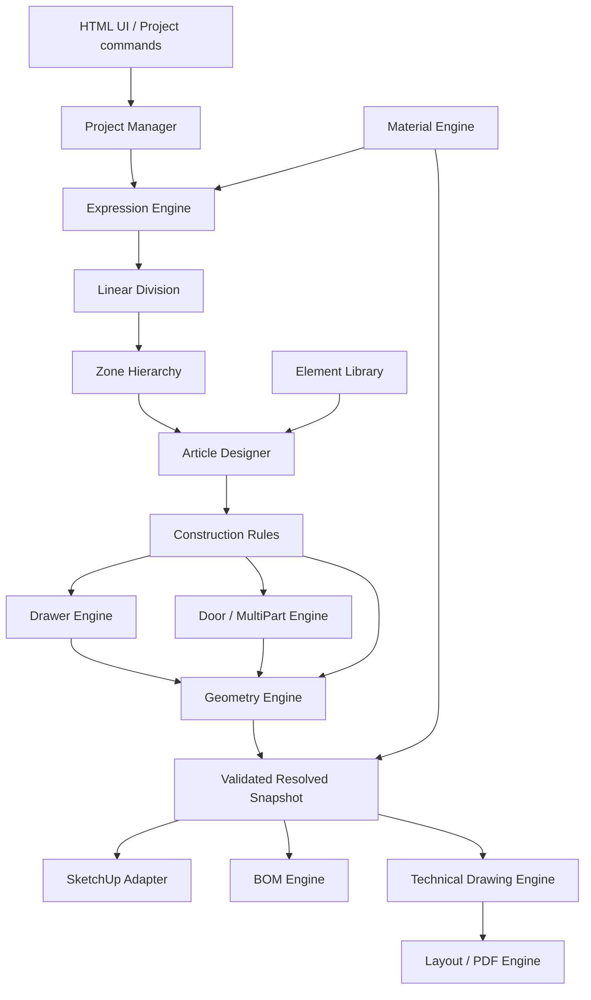

# JP IMOS PRO — Phase 1

Research date: 12 November 2026 (Europe/Berlin). Phase 1B revision. Status: PARTIAL. Research and architecture only.

Evidence labels: **VERIFIED** = explicit inspected evidence; **INFERRED** = conclusion from that evidence; **PROPOSED** = original design; **UNKNOWN** = insufficient evidence. A user requirement verifies requested scope, not proprietary product behavior. No plugin, RBZ, or excluded manufacturing functionality is delivered.

## Recommendation — PROPOSED

Adopt a modular Ruby domain core with no SketchUp API dependency, a thin SketchUp adapter, an embedded HTML/JavaScript UI, and an independent vector drawing pipeline. One immutable resolved furniture snapshot supplies every output. Original rules, formulas and schemas are explicit and versioned; they are not asserted to reproduce imos behavior.

This recommendation is an architectural proposal for approval, not authorization to start Phase 2. The Phase1B source reconciliation below supplies historical evidence while retaining item-specific uncertainties; it does not certify current imos equivalence.

## Alternatives considered

| Approach | Benefit | Cost/risk | Recommendation |
|---|---|---|---|
| Derive all data from SketchUp geometry and dictionaries | Closest to direct modeling workflow | Ambiguous intent, rounding, manual edits and transformed bounds can corrupt regeneration/BOM | Reserve for an optional future import boundary |
| Pure domain core plus host/output adapters | Deterministic rules, shared revisions, testability, portable drawing scene | Requires explicit model and edit/conflict policy | **Recommended** |
| External geometry/constraint service | Process isolation and access to broader libraries | Deployment, offline behavior, protocol/version/licensing overhead | Defer until measured requirements justify it |

No approach was selected by the user beyond the requirement for a canonical model. The recommendation is the architect's proposal.

## Canonical authority

A ProjectDocument contains authored input definitions and accepted resolved_snapshot at one revision. The snapshot contains immutable physical part geometry, assembly occurrences, resolved materials and semantic anchors. Meshes, host entities, BOM aggregates, drawing scenes and PDFs are reproducible projections identified by that revision. They cannot silently write back their own measurements.

Authoring changes produce CandidateRevision. Validate and resolve it in memory; only a successful host operation publishes it as AcceptedRevision. A failed apply leaves the previous document and geometry. External export uses a frozen accepted snapshot and reports its revision; an export failure does not invalidate the model.

The arrows show evaluation data flow; the complete static dependency list is [10](10-module-dependencies.md). Validation participates at every boundary and is not a downstream afterthought.

## Seventeen module contracts

All signatures are conceptual interfaces, not production code.

| # | Module / responsibility | Input → output | Side effects |
|---|---|---|---|
| 1 | Project Manager: persistence, commands, revisions, libraries | ProjectDocument + EditCommand → CandidateRevision / diagnostics | Coordinates save/export/apply; no geometry math |
| 2 | Parametric Expression Engine: parsing, typing, DAG evaluation | Expression + SymbolTable + budget → TypedValue / error spans | None |
| 3 | Linear Division Engine: typed interval allocation | DivisionSpec + clear span + frame → DivisionResult with boundary IDs | None |
| 4 | Article Designer Engine: definition instantiation and orchestration | ArticleInstance + resolved zones + library → construction requests | None |
| 5 | Zone Hierarchy Engine: recursive subdivision and frames | ZoneSpec + parent envelope + DivisionResults → ZoneSnapshot | None |
| 6 | Construction Rules Engine: junctions, offsets, principles | ConstructionRequest + neighborhood → PartRecipes/HardwareRecipes, reservations and diagnostics | None |
| 7 | Element Library: versioned immutable definitions | element_type + version → ElementDefinition | Read curated library data only through Project Manager |
| 8 | Furniture Geometry Engine: physical geometry specs | PartRecipes + resolved dimensions → PartSpecs, contours, solids | None; no SketchUp entities |
| 9 | Drawer Engine: generic/system-profile assembly rules | DrawerRequest + sourced DrawerProfile → PartRecipes + virtual boxes | None |
| 10 | Door/MultiPart Engine: front layout and composition | FrontRequest / MultiPartDefinition → recipes and assembly references | None |
| 11 | Material Engine: inheritance, thickness/edge allowance policy, finishes and grain | Authoring context → material/thickness/edge allowance inputs before evaluation; PartSpecs → semantic face/edge bindings after geometry | None |
| 12 | BOM Engine: quantities and reporting dimensions | ResolvedSnapshot + grouping policy → BOMDocument | None |
| 13 | SketchUp Ruby Adapter: host persistence/geometry/selection | accepted or candidate snapshot + host mapping → ApplyResult | Host operations only on UI thread |
| 14 | HTML/JS Interface: bilingual authoring and review | UI events + validation results → EditCommands | UI only; no authoritative rule evaluation |
| 15 | Technical Drawing Engine: projections, sections, annotations | ResolvedSnapshot + DrawingSpec → DrawingDocument | None |
| 16 | Layout/PDF Engine: sheet composition and vector serialization | DrawingDocument + SheetSet → PDF/SVG or optional LayOut export | Atomic output file writes |
| 17 | Validation/Testing Framework: contracts and diagnostics | all boundary DTOs + policies → DiagnosticSet | Test harness only; validators remain pure |

## Evaluation sequence

1. Validate schema, revisions, definition references, quotas and excluded capability names.
2. Resolve inherited material IDs, finished substrate/surface stack, explicit finished-thickness policies and dimension-affecting edge treatments/allowances first. Edge selections reference declared semantic contour-segment keys; changes invalidate dependent substrate/finished dimensions. Compile a global typed dependency DAG for parameter values, zone intervals and analytic element anchors. Material choices cannot depend on generated geometry. Evaluate ready nodes in topological order; reject cycles and unknown symbols. The following stages describe consumers, not a license to bypass DAG ordering.
3. Resolve zone boundaries and explicit thickness reservations in parent-before-child order.
4. Instantiate elements with resolved neighborhood references. Construction rules normalize inputs; specialized engines return recipes without recursive dispatch back into Rules.
5. Geometry computes contours, thickness, rigid transforms, anchors and analytic extents.
6. Material binds per-face/per-edge finishes and preselected edge treatments to validated generated semantic segments, retaining substrate and finished dimensions. Reject missing segment mappings. This late visual-binding stage cannot alter already resolved substrate/surface dimensions or allowance policy.
7. Validate fit, referential integrity, dimensions and intended overlaps. Produce complete CandidateRevision.
8. Adapter applies geometry plus canonical persistence in one operation; on success Project Manager publishes accepted revision.
9. BOM and drawing/export read only the frozen accepted snapshot. Stale output is visibly marked; never mix dimensions from one revision with materials from another.

Element anchors used as inputs must be analytic values derived from typed parameters and recipes, never measurements of generated solids or host entities. For example a shelf can reference a drawer-envelope top computed from drawer height and offset: the DAG schedules that analytic anchor before the shelf recipe. It cannot reference a face discovered by geometry generation. Zone definitions may depend only on upstream parameters and ancestor boundaries; they cannot depend on descendant element results. Any dependency violating those direction rules, or any cycle, is rejected before geometry. This deliberately restricts Phase 2 instead of requiring an implicit mixed-stage geometry solver.

## Technical drawing architecture

DrawingDocument is an ordered vector scene containing paths, text runs, dimension primitives, section regions, hatch strokes, styles and source anchors. Each viewport stores orientation, scale, crop and source revision. Its geometry comes from canonical contours/solids, never screen capture.

Orthographic views use explicit right/up/view bases. Front looks toward +Y with right +X and up +Z; back looks toward −Y with right −X; left/right look along ±X, with right axes chosen to preserve a consistent upright image. Top/bottom use documented internal basis presets. Isometric uses a stored orthonormal projection basis. Projection maps point p to (dot(p−origin, right), dot(p−origin, up)); depth is dot(p−origin, view). No perspective is required for dimensioned views.

Hidden-line pipeline: transform part boundary geometry; classify candidate feature/silhouette edges; split projected edges at intersections; compare depth against projected faces; suppress or dash occluded intervals. Explicit tolerances handle coincident/coplanar edges. Merely projecting all edges is not accepted as hidden-line removal.

Sections: intersect each solid with a named plane, assemble closed loops with holes, classify cut material, hatch clipped regions, and project remaining geometry. A native section plane display does not supply verified section contours automatically. Details reference a parent view region and their own scale; preserve source anchors. Dimensions derive from semantic points/planes and show model-space values regardless of viewport scale. Dimension witness points that disappear after editing produce dangling-reference errors.

Templates hold page size, margins, title-block fields, styles, reserved regions and viewport slots. Page-space geometry is mm. A4 210×297, A3 297×420, A2 420×594, A1 594×841 and A0 841×1189 mm are proposed standard sheet presets; orientation swaps dimensions. Store custom formats explicitly. Scale 1:n maps model mm to paper mm/n. Line weights and text height are paper-space values.

PDF backend emits vector paths and searchable text; embed a licensed Unicode font covering Albanian ë/Ë/ç/Ç. Use clipping, real line styles, hatch strokes and multiple pages. Raster textures may be optional, but dimensions and technical linework must remain vectors. Backend candidate Prawn is conditional on license/dependency review; SVG serialization is an independent debugging/interchange output. Browser print or canvas screenshots do not establish professional vector export quality.

Optional native LayOut adapter writes its own document representation using the documented API, with separate unit conversion. Native PDF export exists; it is not treated as absent. However full standalone layout/drawing behavior is owned by JP for predictable revision/scale handling.

## Persistence, errors and recovery

Project Manager owns migrations and stable UUID strings. Save canonical authoring data and the accepted snapshot in a namespaced model dictionary, optionally with a portable JSON project document. Model persistence is authoritative for a SketchUp editing session; an external project file is an explicit export/import with revision checks. Do not treat an unsynchronized sidecar as a second live authority.

The adapter observes host undo/redo and model-open events, then schedules a read after the host event completes. It reads the restored canonical document and revision from the model dictionary, replaces Project Manager's accepted in-memory document, rebuilds logical-ID mappings from managed entity attributes, and invalidates all derived snapshot/output/UI caches. It emits revision_changed through the UI bridge without writing a new host operation. Exports and edits remain suspended until this synchronization completes. A missing dictionary after undoing initial creation means no managed project; a geometry/dictionary mismatch creates a conflict diagnostic and blocks export. No observer recomputes or republishes the undone candidate automatically.

Errors are typed: schema, syntax, unit, missing_source, unknown_symbol, cycle, infeasible_span, invalid_geometry, material_missing, conflict, unsupported_host and export_failure. Diagnostic includes code, severity, entity/parameter ID, source span, source evidence and localized message key. Reject invalid changes before deletion of old geometry. Long evaluations must support cancellation between stages; host mutations remain short and synchronous.

## Boundaries and decisions left open

Item-specific historical formula conflicts, numeric drawer-profile contracts, project distribution license, exact runtime builds, PDF package/font choice, host performance budgets and foreign-geometry adoption policy remain open. Initial core scope may support rectangular panel solids, but the schema retains contour/profile support; arbitrary freeform solid booleans should be scheduled only after evidence and tests justify them.

Strict exclusions: no drilling, CNC, CAM, nesting, toolpaths or postprocessors. Hardware is visual/BOM-only. Construction joins describe fit and dimension ownership; they are not machining instructions.

## Phase1B architecture reconciliation

This supersedes manual-absence assumptions in the initial design. No production modules are written. The17-module decomposition remains adequate, but the following responsibilities/submodels were missing or too restrictive.

| Gap | Actual evidence | Required canonical/contract change | Resolution status |
|---|---|---|---|
| Article W/H/D treated as all-visible bounds | Manual Artikull Parametrik.pdf pp. 6 | Separate carcass/reference envelope, finished physical union and optional front/long-piece envelope | PROPOSED correction specified |
| Side construction plane treated generically/right | Manual Artikull Parametrik.pdf pp. 4–5,18–20 | Named plan/front/LEFT-side construction mode, separate from JP/world view frame | Corrected evidence; JP basis remains proposal |
| Disjoint-only child zones | Manual Artikull Parametrik.pdf pp. 51–52 | Zone layer mode: partition versus coextensive independent construction; collision checks operate on resulting parts and explicit intended intersections | PROPOSED correction |
| Generic typed expression rejects1+100mm; division always clear-span | Manual Ndarja Lineare.pdf pp. 8,11–12; Manual Artikull Parametrik.pdf pp. 43 | Separate affine division grammar, reference faces and construction-point context; preserve source conflicts | Specified in 03 |
| Nominal-thickness-only or nongeometric-all-finishes | Manual Menaxhimi i Elementeve.pdf pp. 11,15,18,21 | Early Material resolves finished substrate AND dimensional surface stack AND edge allowances before any geometry-dependent value | Corrected evaluation contract |
| MultiPart “virtual=no descendants” | Manual Menaxhimi i Elementeve.pdf pp. 29; Manual per krijimin e dyerve.pdf pp. 1 | Reservation thickness, pointset, physical child graph and display proxy distinct | Corrected |
| Back single-face setback and universal offset sign | Manual Menaxhimi i Elementeve.pdf pp. 67,77–80,96–97,105,113 | Typed reference face/member, engagement, recess fit and source-sign normalization | Corrected; arbitrary angled formulas remain open |
| Inside drawer box interpreted as storage | Variablat e brendshme te Sirtareve ne Imos.pdf pp. 1 | Outside admissible envelope; inside construction anchors; optional usable-storage calculation separate | Corrected |
| One drawer↔one front assumption | Manual Sirtaret.pdf pp. 15–16 | Shared front occurrence link; count real front once | Corrected |
| Organizational bill-of-elements omitted | Manual Manager.pdf pp. 9–10,19–28;00_Manager.pdf same pages | Authored OrderGroup separate from derived BOMDocument | Corrected |
| Edit scope only one untyped map | Manual Manager.pdf pp. 89–91;00_Manager.pdf pp. 89–91 | Definition-global, project-local, occurrence-local recording intent; version publication explicit | Corrected |
| Title fields unscoped / missing viewport policy records | Manual Skuadrim dhe Layout.pdf pp. 6–12 | Source-bound field resolution, global/project template variants, per-viewport visibility/scale | Corrected |

### Revised evaluation order and dependencies

Project Manager resolves library/override scope → early Material resolves finished dimensional stacks/edge allowances → typed parameters, affine divisions and analytic anchors evaluate in DAG → partition and independent-layer zone references resolve → Construction Rules and specialized Drawer/Door/MultiPart engines emit recipes → Geometry creates validated physical contours/solids/semantic segments, substrate and finished envelopes → late Material binds visual finishes → accepted Snapshot → host/BOM/technical drawing/layout/PDF. No back-edge from generated geometry to input expressions is allowed.

A physical face-layer thickness change is an EARLY dependency, while a texture change may be a late render-only invalidation. Reference-face changes must invalidate back position, clear depth, affected shelf/drawer recipes, sections and dimensions. Source edge1 / report measurement frame is distinct from actual part placement; changing it affects reporting/drawing orientation without changing volume.

Construction Rules' output contract is PartRecipes/HardwareRecipes plus explicit reservations and diagnostics, never prevalidated PartSpecs or SketchUp entities. The Geometry Engine owns the latter. Profile/recess subcomponents belong within Geometry, not a new machining module. Independent layers and shared-front occurrences must not accidentally duplicate physical parts.

The model adds submodels rather than another large feature module: PointSet/ReferenceResolver within Article/Geometry; FinishedStackResolver within Material; FrontLayoutPolicy within Door/Drawer; OrderGroup/RecordingScope within Project Manager; FieldBindingResolver and TemplateStore within Layout. See09–10 for exact proposed fields and ports.

### Boundaries retained

Immutable snapshots, atomic undo, UUIDs, standalone vector occlusion/section/detail algorithms, Unicode embedding and JSON schema remain original JP proposals. Historical Manager undo is more limited (both Manager PDFs6). The layout manual documents paper/view/template operations, not the proposed standalone PDF engine. No current imos version behavior or live SketchUp runtime performance is certified.
